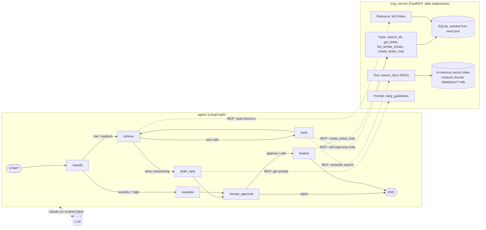

# helpdesk-agent

A small, readable demo of an **IT helpdesk triage agent**:

- an **MCP server** (`mcp_server/`) that exposes helpdesk data as tools, a resource and a prompt,
  including **RAG** (semantic search over runbooks, with local embeddings)
- a **LangGraph agent** (`agent/`) that classifies a request, researches it with those tools,
  drafts a reply, **pauses for a human to approve**, then writes a note on the ticket
- **tests that cost nothing** (a scripted fake model replaces Claude) and a GitHub Actions CI

## Architecture



`human_approval` calls `interrupt()`. The run stops there, its state is saved in the
checkpointer, and it resumes when a person answers.

## Layout

| Path | What it is |
|---|---|
| `mcp_server/server.py` | The MCP server: 4 tools, 1 resource, 1 prompt |
| `mcp_server/rag.py` | RAG retrieval: chunk the runbooks, embed them, search by cosine similarity |
| `mcp_server/data/docs/` | 8 runbooks and policies for a made-up company (all fictional) |
| `mcp_server/db.py` | SQLite storage, created from `mcp_server/data/seed.json` (10 KB articles, 15 tickets) |
| `agent/state.py` | Typed graph state (`TicketState`) and the `Classification` schema |
| `agent/graph.py` | The graph: nodes, conditional edges, interrupt |
| `agent/mcp_client.py` | Starts the MCP server over stdio and loads its tools as LangChain tools |
| `agent/llm.py` | Uses Claude if credentials are set (API key or Workload Identity Federation), otherwise the fake model |
| `agent/fake_model.py` | `ScriptedChatModel`: returns pre-written messages in order |
| `agent/__main__.py` | The CLI |
| `tests/` | MCP unit tests, RAG tests and retrieval eval, end-to-end graph tests, one opt-in live test |

## Run it

Requires [uv](https://docs.astral.sh/uv/). uv installs Python 3.12 for you if needed.

```bash
git clone <your-repo-url> helpdesk-agent && cd helpdesk-agent
uv sync                                   # create .venv with the locked dependencies

uv run pytest                             # all tests, fake model, free
uv run ruff check . && uv run ruff format --check .

# CLI without a key: the scripted fake model (canned replies, real MCP data)
uv run python -m agent "printer on 3rd floor offline" --ticket T-1003
uv run python -m agent "my laptop was stolen"        # high severity -> escalate path

# CLI with Claude
export ANTHROPIC_API_KEY=sk-ant-...
uv run python -m agent "printer on 3rd floor offline"
uv run pytest -m live                     # the one live smoke test
```

The CLI prints each node as it runs, pauses at `human_approval`, and asks
`[a]pprove, [e]dit, [r]eject?`. It then resumes the same run from its checkpoint.

The first RAG search downloads the embedding model (~70 MB, once). Set `FASTEMBED_CACHE_PATH`
to choose where it's kept (the default is a temp folder).

The default model is `claude-opus-5-5`. Set `HELPDESK_MODEL` to use another one.

The database file `mcp_server/data/helpdesk.db` is created on first use and is git-ignored.
Delete it to reset the data. Tests use a temporary copy through `HELPDESK_DB`.

### Explore the MCP server on its own

```bash
uv run mcp dev mcp_server/server.py       # MCP Inspector in the browser (needs Node.js)
```

## CI

`.github/workflows/ci.yml`:

- **`test`** runs on every push to `main` and every PR: `uv sync --locked`, ruff, pytest.
  It uses the fake model and needs no secrets. The embedding model is cached between runs
  (`actions/cache`), so it downloads only once.
- **`live-smoke`** runs only when started by hand (Actions tab, "Run workflow", on `main`).
  It runs `pytest -m live` and authenticates with **Workload Identity Federation**
  instead of an API key (see the next section).

### Set up Workload Identity Federation for the live job

The job asks GitHub for a signed OIDC token (`id-token: write`) and the Anthropic SDK
exchanges it for a Claude access token that lasts a few minutes. No Claude key is stored in GitHub.

1. **In the Claude Console:** open Settings, then
   [Workload identity](https://platform.claude.com/settings/workload-identity-federation),
   click **Connect workload**, and pick **GitHub Actions**. The wizard creates three things:
   - a **federation issuer** for `https://token.actions.githubusercontent.com` (discovery mode)
   - a **service account** (the identity the job runs as; usage is billed to its workspace)
   - a **federation rule** that decides which workflow runs are trusted. Keep it narrow
     (set these under **Advanced match options**):

     ```text
     Subject pattern:   repo:<owner>@<owner_id>/helpdesk-agent@<repo_id>:ref:refs/heads/main
     Claims:            repository_owner = <owner>
                        repository_id    = <repo_id>
                        event_name       = workflow_dispatch
                        ref              = refs/heads/main
     Expected audience: https://api.anthropic.com
     ```

     This allows only manual runs on `main` of this one repo. Other branches, pushes and
     pull-request runs are rejected.

     **Check your subject format.** Newer repos use GitHub's *immutable* subject, which
     contains numeric IDs (`repo:owner@123/name@456:...`), and the wizard may prefill the
     older `repo:owner/name:*` form, which won't match. Find yours with
     `gh api repos/<owner>/<repo>/actions/oidc/customization/sub` (see `sub_claim_prefix`).
2. **In GitHub:** go to Settings, Secrets and variables, Actions, **Variables** (not Secrets;
   these are IDs, not credentials) and add:
   - `ANTHROPIC_FEDERATION_RULE_ID`: `fdrl_...`
   - `ANTHROPIC_ORGANIZATION_ID`: from the Console's Organization page
   - `ANTHROPIC_SERVICE_ACCOUNT_ID`: `svac_...`
   - `ANTHROPIC_WORKSPACE_ID`: `wrkspc_...` (needed only if the rule covers several workspaces)
3. **Run it:** Actions tab, CI, Run workflow (on `main`). If it fails, the exchange returns
   a bare `401 Authentication failed`. The real reason (most often `match_subject_prefix`)
   is in the Console's Workload identity page, on the **History** tab.

Locally, keep using `ANTHROPIC_API_KEY`. Federation is for workloads that have their own
identity, such as CI, cloud VMs or Kubernetes.

## Talking points

### Why MCP instead of hardcoded tools?
- **Decoupling.** The agent never imports server code. It speaks a protocol, so this same
  server works with Claude Desktop, Claude Code or any other MCP client, and the agent
  could use any other MCP server. The tools are written once and work in every client.
- **Discovery.** Tool names, descriptions and JSON schemas come from the server at runtime
  (`list_tools`). FastMCP builds the schemas from Python type hints and docstrings.
- **A boundary for ownership and security.** The team that owns the data owns the server,
  including validation, rate limits and, later, auth. The agent team owns the reasoning.
- **Three primitives, three controllers:**
  - **Tools** are chosen by the *model* (`search_kb`, ...).
  - **Resources** are read by the *app* to give context (`kb://index`; `retrieve` puts it in the system prompt).
  - **Prompts** are templates the *server* publishes so every client behaves the same (`reply_guidelines`, used by `draft_reply`).
- Trade-off: an extra process and a protocol hop. For one script with one tool, a plain
  function is simpler.

### How the RAG pipeline works (`mcp_server/rag.py`)
- **Pipeline:** load the markdown runbooks, **chunk** them (one chunk per `##` section), then
  **embed** each chunk into a 384-number vector. Keep the vectors in a numpy array (the
  **index**). At query time, embed the question and rank chunks by **cosine similarity**.
  The **generation** step is the agent: `draft_reply` writes the answer from the retrieved
  chunks and cites their source files.
- **Why RAG?** The runbooks are too long to put in every prompt and they change over time.
  Retrieval sends only the few relevant sections, so prompts stay small and answers are
  grounded in current documents the model was never trained on.
- **Why semantic search, not keywords?** "battery is puffing up" matches the section
  "Swollen or hot battery" even though the words differ. `search_kb` (keyword
  search) is kept next to it for contrast.
- **Chunking choices.** Each section is a natural, self-contained unit. The doc and section
  titles are prepended before embedding (a "contextual chunk header"), so a section like
  "Gateway outages" still says it's about the VPN. For long, unstructured text you'd use
  fixed-size windows with overlap.
- **Embeddings run locally** (fastembed, `BAAI/bge-small-en-v1.5`, ONNX on CPU). They're
  free, need no key, and give the same vectors every run, which keeps tests deterministic.
  bge models expect a prefix on queries but not on documents, so the code uses
  `query_embed` and `passage_embed`.
- **It's behind MCP**, so any MCP client gets RAG through one tool call (`search_docs`), and
  the agent doesn't know how retrieval works.
- **Measured, not just demoed.** `tests/test_rag.py` has a small labeled eval: 10 everyday
  questions, each with the doc that answers it. It checks **hit@3** (the right doc is in
  the top 3), and it runs in CI.

### Why a graph instead of a plain agent loop?
- **Control flow you can see and test.** Required steps (classify, approval, the ticket
  write) are fixed edges. The model only decides inside `retrieve`, which is a small,
  bounded tool loop.
- **Deterministic branches.** High severity always escalates through code, never by
  the model's choice. Escalation uses no LLM at all.
- **Least privilege.** The model is bound only to *read* tools. The single write
  (`create_ticket_note`) runs in `finalize`, after a human approves. A test checks
  that the model can't call it.
- **Typed state.** `TicketState` shows exactly what each node reads and writes. The
  `messages` key uses the `add_messages` reducer (append), and the other keys are overwritten.
- **Easy to test.** Every path is asserted node by node in `tests/test_agent_graph.py`.

### How interrupts and checkpoints work
1. `human_approval` calls `interrupt(payload)`. LangGraph saves the full state to the
   **checkpointer**, keyed by `thread_id`, and returns the payload to the caller under
   `__interrupt__`.
2. The process could stop here. With a persistent checkpointer (SQLite or Postgres) the run
   could resume hours later on another machine. This demo uses `InMemorySaver` (also called
   `MemorySaver`), so the pause only lasts as long as the process.
3. The caller resumes with `Command(resume={"action": "approve"})` and the same `thread_id`.
4. The interrupted node **re-runs from the top**, and this time `interrupt()` *returns* the
   resume value. So code before `interrupt()` must have no side effects (no writes, no emails).
5. `app.aget_state(config)` shows the paused state and `snapshot.next == ("human_approval",)`.

### How CI avoids paid LLM calls
- No key means `ScriptedChatModel`. It returns a fixed list of `AIMessage`s (classification
  JSON, tool calls, reply text) in call order. Tests are deterministic and free.
- Everything else in the tests is real: the MCP server runs as a stdio subprocess on a
  temporary SQLite copy, and the tools, resource, prompt, interrupts and checkpoints all run.
- The live test is marked `@pytest.mark.live`, excluded by default (`-m 'not live'`),
  skipped without a key, and runs in CI only when started by hand.
- Limit: the fake proves the *wiring*, not answer *quality*. That needs evals (below).

### Why federation instead of an API key in CI
- **No long-lived secret.** A leaked API key works until someone revokes it. A federated
  token lasts minutes and can only be obtained by a run that matches the rule.
- **Scoped by identity.** The rule pins the repo, the branch and the owner, so forks and PRs
  can't get a token. Every exchange is logged in the Console.
- **Nothing to rotate.** GitHub signs a fresh token for every run.
- **A LangChain gotcha I hit:** `ChatAnthropic` always passes `api_key=""` to the SDK, and
  the SDK treats any explicit argument as "caller chose the credentials", so it never
  looked at the federation variables. `SDKAuthChatAnthropic` (`agent/llm.py`) builds the
  SDK clients with no credential arguments, so the SDK's own lookup runs: API key, auth
  token, profile, then federation. `tests/test_llm.py` checks this offline.

### What I'd add for production
- **HTTP transport + auth on MCP.** Streamable HTTP instead of stdio, so the server runs as
  its own service, with OAuth (the MCP spec's authorization flow) and per-user permissions
  on `create_ticket_note`.
- **Persistent checkpointer** (`langgraph-checkpoint-postgres`) so approvals survive restarts,
  and an approval UI or Slack button instead of a terminal prompt.
- **Evals.** A labeled set of requests to measure classification accuracy, retrieval hit
  rate (did it find the right KB article?) and reply quality (LLM-as-judge plus human
  spot checks), run on each prompt or model change.
- **Observability.** Traces per run (LangSmith or OpenTelemetry), token and cost metrics,
  tool error rates, and how often humans edit or reject drafts.
- **RAG at scale.** A real vector store (pgvector or a managed one) built by an
  ingestion job that re-embeds docs when they change. Add hybrid search (keyword +
  vector), a reranker, metadata filters (team, region, access level, so people only
  retrieve docs they're allowed to see), and a larger retrieval eval tracked over time.
- **Hardening.** Timeouts and retries on tool calls, a cap on the number of tool rounds,
  and treating tool output as untrusted input (prompt-injection risk in KB or ticket text).
- **Upgrade to the `mcp` 2.x SDK** (FastMCP was renamed `MCPServer`) once
  `langchain-mcp-adapters` supports it. Today the adapter requires `mcp<2`, so `mcp` is pinned at 1.29.1.

## Pinned versions

| Package | Version | Note |
|---|---|---|
| langgraph | 1.2.16 | |
| langchain-core | 1.7.0 | |
| langchain-anthropic | 1.7.6 | |
| mcp | 1.29.1 | last 1.x; adapter needs `mcp<2` |
| langchain-mcp-adapters | 0.3.2 | |
| fastembed | 0.9.0 | local embeddings (ONNX), for RAG |
| pytest / pytest-asyncio / ruff | 9.1.1 / 1.4.0 / 0.17.2 | dev only |

Exact versions of everything, including transitive dependencies, are in `uv.lock`.

### Claude settings worth knowing (`agent/llm.py`, `agent/graph.py`)
- No `temperature`: current Claude models reject sampling parameters.
- Structured output uses `method="json_schema"` (the API's `output_config.format`). The
  default `function_calling` mode forces a tool choice, which current Opus models reject.
- Server-side refusal fallback is on (`fallbacks: "default"`). If a safety classifier
  declines a request, the API retries it on a fallback model within the same call.
